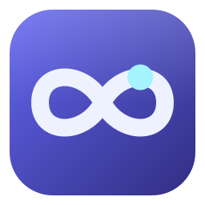

<div align="center">



# Continuous

**A community-maintained fork of the Continue VS Code extension.**

</div>

> **Unofficial fork.** Continuous is not affiliated with, endorsed by, or supported by Continue Dev, Inc. The upstream `continuedev/continue` repository is no longer maintained. This fork carries its own changes (AWS Bedrock and Bedrock Mantle support, live model lists, and more) and is released separately.

## Install

Continuous needs a recent VS Code (1.105 or newer).

**From VS Code or the Marketplace** (the usual way):

- In VS Code, open the Extensions view (`Ctrl+Shift+X`), search for **Continuous**, and select **Install**. Check the publisher is `b1tninja`.
- Or open the [Continuous page on the Visual Studio Marketplace](https://marketplace.visualstudio.com/items?itemName=b1tninja.continuous) and select **Install**.
- Or from a terminal:

  ```bash
  code --install-extension b1tninja.continuous
  ```

VS Code keeps the extension up to date. The Marketplace extension ID is `b1tninja.continuous`.

**From a GitHub release** (to install by hand, or where the Marketplace is not reachable):

1. Download the `.vsix` for your platform from the [latest release](https://github.com/b1tninja/continuous/releases/latest). There are builds for Windows (x64, Arm64), macOS (Apple Silicon, Intel), and Linux (x64, Arm64). Each release has a `SHA256SUMS.txt` to check the download against.
2. Install it, then reload VS Code (**Developer: Reload Window**):

   ```bash
   code --install-extension <the file you downloaded>.vsix --force
   ```

Or, with the GitHub CLI (change `win32-x64` to your platform):

```bash
gh release download --repo b1tninja/continuous --pattern "continuous-win32-x64-*.vsix" --pattern SHA256SUMS.txt --dir continuous-vsix
```

Continuous installs alongside the original Continue extension. Its configuration is in `~/.continuous`, which the first start copies from an existing `~/.continue`. If you installed one of the early releases, which used the ID `b1tninja.continued`, uninstall that one after installing Continuous ([details](docs/continuous-install.md#4-reload-vs-code)).

The [install guide](docs/continuous-install.md) has every platform's file name, checksum commands, unreleased builds from GitHub Actions, and troubleshooting.

## What's different from upstream

- **Amazon Bedrock**: one model list across the standard Bedrock endpoint and the Mantle endpoint. Mantle-only models are saved with the right provider automatically.
- **Live model lists**: after **Test connection** or the refresh button, the model picker shows the models your account can use, newest first.
- **Claude 4.6 and later**: uses adaptive thinking, which these models require.
- **Current models**: refreshed lists for Anthropic, OpenAI, Gemini and Bedrock.

## Documentation

The documentation is at [b1tninja.github.io/continuous](https://b1tninja.github.io/continuous/), built from `docs/`. It still describes upstream Continue in places and is being revised. What changed in each release is in the [release notes](https://github.com/b1tninja/continuous/releases).

## Upstream

This fork starts from the final release of Continue (`continuedev/continue`, VS Code extension 2.0.0). Upstream is no longer maintained, and its CLI, JetBrains plugin and its own Marketplace listing are not part of this fork. Upstream's project history and contributors are at [continuedev/continue](https://github.com/continuedev/continue).

## License

Apache 2.0. The original work is © 2023–2026 Continue Dev, Inc. Changes in this fork are © 2026 b1tninja. See [LICENSE](LICENSE). This fork is not endorsed by or affiliated with Continue Dev, Inc.
