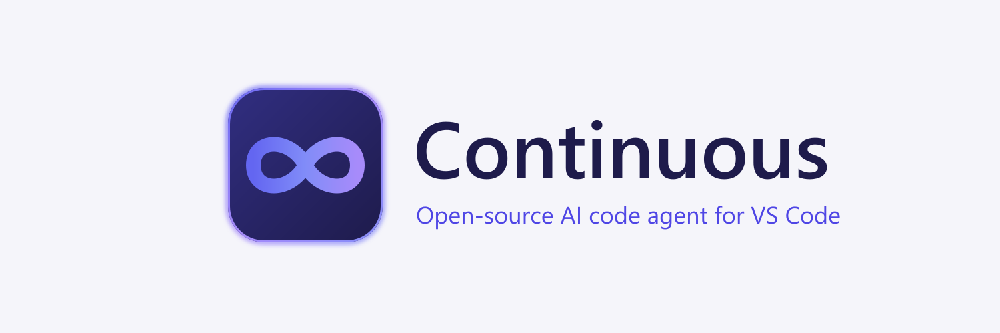

<h1 align="center">Continuous</h1>

**An open-source AI code agent for VS Code: agent, chat, edit and autocomplete with the models you choose.**

> **Unofficial, community-maintained fork.** Continuous is not affiliated with, endorsed by, or supported by Continue Dev, Inc.

**Privacy:** no telemetry, no account, and only the model hosts you configure are contacted. Details: [PRIVACY.md](https://github.com/b1tninja/continuous/blob/main/PRIVACY.md).

## Features

- **Agent**: hand it a development task; it reads and edits files and runs tools, asking before anything risky.
- **Chat**: ask about your code, with files, folders and other context attached.
- **Edit**: change the selected code in place, reviewing the diff before you accept it.
- **Autocomplete**: inline suggestions as you type, from a local or hosted model.

## What this fork adds

- **Amazon Bedrock**: one model list across the standard Bedrock endpoint and the Mantle endpoint.
- **Live model lists**: after **Test connection**, the model picker shows the models your account can use, newest first.
- **Current models**: up-to-date lists and limits for Anthropic, OpenAI, Gemini and Bedrock.
- **Sturdier streaming**: a dropped connection is retried before the reply starts, and a reply that is cut off says so.
- **Plan and Loop modes**: plan into a saved plan file, then build its to-dos one at a time, each with a check that must pass.
- **Tool permissions**: allow, ask and deny rules, policy levels per area, and protected paths that always ask.
- **Resume**: carry on a stopped or failed response without retyping; tool calls that already ran are not run again.
- **A terminal agent**, `continuous`, attached to each GitHub release.

## Install and set up

Install Continuous from the Extensions view (publisher `b1tninja`), or by hand from a `.vsix` file on a GitHub release. Downloads, checksums and troubleshooting for the `.vsix` are in the
[install guide](https://github.com/b1tninja/continuous/blob/main/docs/continuous-install.md).
Source and issues: [github.com/b1tninja/continuous](https://github.com/b1tninja/continuous).

## License

Apache 2.0. The original work is © 2023–2026 Continue Dev, Inc. Changes in this fork are © 2026 b1tninja.
See [LICENSE](./LICENSE.txt). This fork is not endorsed by or affiliated with Continue Dev, Inc.
