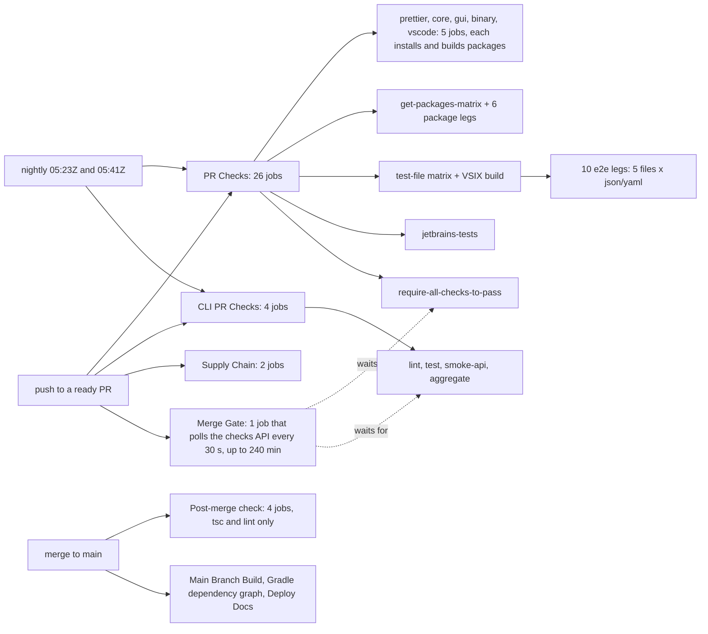
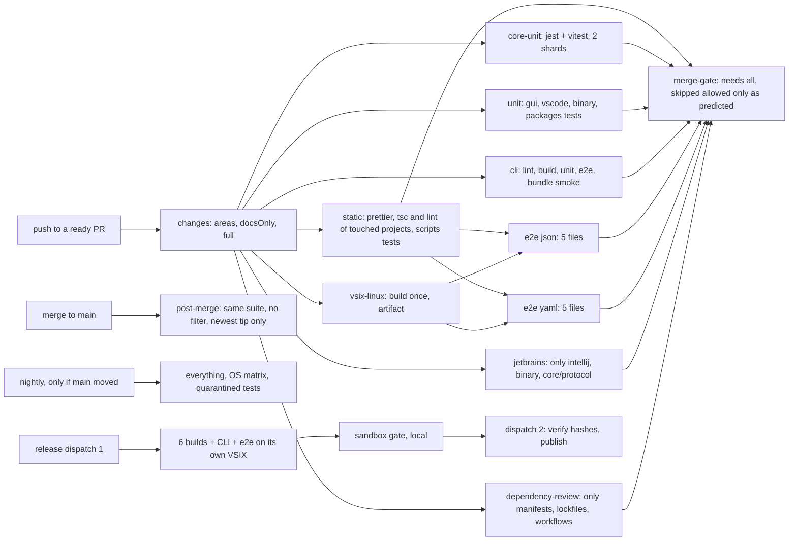

# Research: CI/CD pipeline redesign (affected-only testing, reuse, topology, queueing, capacity, release)

Date: 2026-11-13. Scope: why a pull request in `b1tninja/continuous` waits hours for a result, and a target pipeline that runs less, reuses more and queues less, without letting a regression through. This note builds on `area-ci-privacy-release.md` (sections 3, 4 and 13: CI30 to CI41), `test-quality-strategy.md` (test tiers, flake ledger, job timings) and draft PR #751 (non-polling `merge-gate` with a `changes` filter). It does not repeat their designs; it measures again, adds what they leave open and says how the pieces compose. Nothing here changes a workflow or `plans/ROADMAP.md`; section 12 holds the proposed rows.

## 0. Summary

The owner's question was "running every test every time is a huge bottleneck". The measurement says the bottleneck is mostly something else, and that running fewer tests is the second lever, not the first.

1. **The polling `merge-gate` used 62.9% of all runner time.** Over 700 completed runs (2026-11-13 02:07Z to 14:54Z, 1,822 jobs that got a runner), jobs ran for 8,913 runner-minutes; `merge-gate` alone held 5,605 of them (median 15.6 min per gate job, p90 200 min). Everything else (every PR check, post-merge, release and docs job in those 13 hours) took about 3,300 runner-minutes, roughly 250 per hour against a capacity of 1,200 per hour (20 slots). Without the poller the same day's load fits in about a quarter of the cap. **Land #751 first**; nothing else on this list comes close.
2. **Wall time is almost all queue.** The longest chain of jobs in `PR Checks` takes about 9 minutes when nothing queues (JetBrains 8.2, core 6.6, VSIX 3.4 then e2e 2.0). Measured from run creation to the end of `PR Checks`, a green push took a median of **121 minutes** and p90 **280 minutes**; an e2e leg waited a median of 45 minutes and p90 191 minutes for a runner. At 15:25Z today 145 runs were queued.
3. **A code push starts 33 jobs, and about a third of each push's 65 runner-minutes is setup.** `Setup packages` runs `build-packages.js` in 24 jobs per push (27 to 30 s each), `Setup core component` in nine (17 s), checkout in all (5 to 18 s). Ten e2e legs each pay for a runner, a checkout, a download and a display server to run a 1 to 2 minute test.
4. **Half the completed PR runs were red, mostly for cheap reasons.** 20 of 41 completed `PR Checks` runs failed; across the window the jobs that failed were `gui-checks` (14 times), `prettier-check` (11), CLI `test` (4) and `core-checks` (3). Every red run also paid for its 10 e2e legs and the JetBrains build. A cheap stage that runs first, and a local pre-push check, remove most of that.
5. **28% of PR pushes were superseded** (24 of 87 pushes that reached `PR Checks` were cancelled by a newer push). `cancel-in-progress` already handles this; batching pushes helps more than any CI change.
6. **Affected-only testing pays, but per directory first and per file later.** In a replay of the last 120 merged PRs, 62 were docs-only and 30 of the 58 code PRs touched `core/` or `packages/`, which every other component consumes. Directory-level selection (#751 plus this note's topology) cuts jobs from 1,976 to 590 and runner-minutes from 3,770 to about 1,716 over those 120 PRs. File-level selection (`vitest --changed`, import graph) is the next step and is safe only with a full run after merge, nightly and on the release candidate; it is phase 3, in shadow mode first.
7. **Turborepo and Nx do not fit this repository today.** There are 14 separate lockfiles linked by `file:` dependencies and no npm workspaces; both tools assume workspace discovery. A home-grown area map (#751's `changed-areas.mjs`) plus Vitest's own selection inside a package gives most of the benefit without a repository migration.
8. **Capacity:** larger runners are billed even for public repositories; a free organisation still has 20 concurrent jobs (60 needs Team, $4 per user per month); a self-hosted runner on the owner's machine must never serve `pull_request` workflows on a public repository. Recommended: no capacity purchase now; re-measure after phase 2.
9. **Merging:** the rule "every merge makes the others stale and they need a fresh run" turns N ready PRs into up to N(N-1)/2 runs. Replace it with a scripted merge train (one CI run for a batch, tree-hash checked) plus a post-merge full run, and re-run a PR only when it conflicts or overlaps what landed.

Target, per code push: 2 to 12 jobs (median 7 over the replay, was 33), about 30 runner-minutes (was 65), about 12 minutes of unqueued wall time (was 9, but it was never unqueued); docs-only 2 jobs under 2 minutes. A burst of 20 ready PRs drains in about 30 minutes of cap time instead of about 65 (without the poller) or never (with it).

## 1. Sources and method

- Repository: a fresh clone of `origin/main` at `4d68a833c` (2026-11-13), all 14 workflow files, the 7 composite actions in `.github/actions/`, `scripts/ci/`, `scripts/build-packages.js`, `package.json` and the Vitest and Jest configs of `core`, `gui`, `binary`, `extensions/vscode` and `extensions/cli`.
- Draft PR #751: body and diff (`gh api repos/b1tninja/continuous/pulls/751/files`), including `scripts/ci/changed-areas.mjs` and its job-count table. PR #650 (cache audit): body.
- GitHub REST, read-only, 2026-11-13 15:00Z to 15:40Z:
  - `actions/runs?status=completed` (7 pages, 700 runs, created 02:07Z to 14:54Z) and `actions/runs/{id}/jobs` for each (695 runs with jobs, 3,165 jobs, 1,822 assigned a runner). Wait = job `started_at` minus `created_at`; run time = `completed_at` minus `started_at`; only jobs with a `runner_name` count as running. The concurrency sweep is over start and completion timestamps at one-second resolution.
  - `pulls?state=closed` and `pulls/{n}/files` (with `previous_filename`) for the last 120 merged PRs (merged 2026-11-12 06:55Z to 2026-11-13 14:46Z) for the replay in section 4.4.
  - `actions/cache/usage` and `actions/caches` at 15:2xZ; `actions/runs?status=queued` and `in_progress` counts at 15:25Z.
- No run was cancelled or re-run, no setting was read beyond what the endpoints above return, and nothing was changed on GitHub.
- External sources: section 13, each with its fetch date. Statements not confirmed by a fetched primary source are marked **unverified**.
- Numbers are from one weekday window. They describe this repository's current load (agents pushing many PRs); a quieter week will show less queue but the same per-push cost.

## 2. Current state

### 2.1 What one code push starts

Docs-only pushes (`docs/`, `docs-site/`, `plans/`, `*.md`, `*.mdx`, `LICENSE`) are skipped by `paths-ignore` and start only the gate, which returns in seconds. Drafts start the workflows but every job is skipped except the gate, which fails on purpose. `PR Build And Upload VSIX` created 129 runs in the window, all skipped (it builds only with the `build-vsix` label).

### 2.2 Measured numbers (2026-11-13, 02:07Z to 14:54Z)

| Measure                                                               | Value                                                                                             |
| --------------------------------------------------------------------- | ------------------------------------------------------------------------------------------------- |
| Completed runs / jobs / jobs that got a runner                        | 700 / 3,165 / 1,822                                                                               |
| Runner-minutes used                                                   | 8,913 (`Merge Gate` 5,605, `PR Checks` 2,612, `CLI PR Checks` 532, everything else 164)           |
| Share of runner time held by `merge-gate`                             | **62.9%**                                                                                         |
| Peak concurrent jobs                                                  | 20 (one sample at 21, an artefact of second-resolution timestamps)                                |
| Time at 20 concurrent jobs / at 18 or more                            | 20.1% / 56.2% of the 13.2 hours                                                                   |
| PR pushes that reached `PR Checks`                                    | 87 (21 green, 20 red, 24 superseded and cancelled, rest skipped as draft)                         |
| Jobs per code push                                                    | 33 (median)                                                                                       |
| Runner-minutes per code push, gate excluded                           | 65 (median of completed pushes)                                                                   |
| Run creation to `PR Checks` finished, green pushes                    | median 121 min, p90 280 min                                                                       |
| Same, red pushes                                                      | median 267 min, p90 283 min                                                                       |
| Unqueued critical path (sum of run-time medians on the longest chain) | about 9 min                                                                                       |
| Red rate of completed `PR Checks` runs                                | 20 of 41 (49%)                                                                                    |
| Queued and running runs at 15:25Z                                     | 145 queued, 15 in progress                                                                        |
| Actions cache                                                         | 46 entries, 11.57 GB active against the 10 GB default limit                                       |
| Flake rate                                                            | not measurable from this window: no job was retried on the same SHA; 1 e2e leg failed of 450 legs |

Per job (jobs that got a runner; minutes):

| Workflow / job                   | Runs | Wait p50 | Wait p90 | Run p50 | Run p90 | Largest steps (median seconds)                                             |
| -------------------------------- | ---: | -------: | -------: | ------: | ------: | -------------------------------------------------------------------------- |
| PR Checks / prettier-check       |   66 |     13.9 |    116.6 |     0.9 |     1.2 | prettier 43                                                                |
| PR Checks / core-checks          |   66 |     13.2 |    115.3 |     6.6 |     8.2 | tests 292 (jest about 40, vitest the rest), tsc+lint 48, setup 44          |
| PR Checks / gui-checks           |   66 |     10.8 |    113.7 |     4.8 |     6.2 | tests 182, tsc+lint 40, setup 54                                           |
| PR Checks / binary-checks        |   66 |     13.2 |    109.4 |     1.1 |     1.4 | setup 51, tsc 10                                                           |
| PR Checks / vscode-checks        |   66 |     16.2 |    110.5 |     1.6 |     2.0 | setup 44, tsc+lint 26, vitest 5, esbuild check 6                           |
| PR Checks / packages leg (x6)    |  301 |     31.6 |    168.6 |     0.9 |     1.3 | setup packages 28, checkout 19, tests up to 17                             |
| PR Checks / test-file matrix     |   66 |     16.1 |    134.0 |     1.0 |     1.2 | build packages and compile e2e 36                                          |
| PR Checks / VSIX build (linux)   |   66 |     13.1 |    132.8 |     3.4 |     4.4 | build 169, post-step cache save 27                                         |
| PR Checks / e2e leg (x10)        |  450 |     44.8 |    191.2 |     2.0 |     2.9 | whole action 109                                                           |
| PR Checks / jetbrains-tests      |   66 |     15.8 |    122.7 |     8.2 |     9.7 | Gradle 387, free disk space 104                                            |
| CLI PR Checks / test (ubuntu 22) |   70 |      8.6 |    110.0 |     5.0 |     6.1 | unit 166, e2e 44, setup 47, core build 19                                  |
| CLI PR Checks / lint             |   70 |      6.4 |     98.7 |     1.7 |     2.2 | setup 44, lint 22, core build 18                                           |
| CLI PR Checks / smoke-api        |   69 |      8.1 |     84.9 |     1.5 |     1.7 | setup 44, core build 21; every test skips (no secrets, `test-quality` 2.3) |
| Supply Chain (2 jobs)            |   84 |  6.7-8.5 |    63-67 |     0.2 |     0.3 |                                                                            |
| Merge Gate / merge-gate          |   95 |      7.7 |     70.1 |    15.6 |   200.3 | polling                                                                    |

### 2.3 What the numbers mean

- **Throughput.** 20 slots give 1,200 runner-minutes per hour. Real work arrived at about 250 per hour on average; the pollers took most of the rest. Without them, the cap binds only in bursts (20 PRs made ready together, or a merge storm with "Update branch" on each).
- **Bursts.** A burst of N code pushes needs about N x 65 / 20 minutes of cap time to drain: 65 minutes for 20 pushes, before any re-run. This is where fewer jobs and fewer minutes per push matter.
- **Per-job queueing.** Each of the 33 jobs waits separately, and jobs that start later in the chain (e2e legs, which need the VSIX build) wait behind every job queued meanwhile: their median wait was 45 minutes against 13 for first-stage jobs. Fewer, longer jobs and fewer stages shorten wall time even at equal minutes.
- **Setup.** Per code push, roughly 24 x 28 s (`Setup packages`) + 9 x 17 s (`Setup core component`) + 33 x about 15 s (checkout and `setup-node`) is about 22 runner-minutes, a third of the 65. `Setup packages` runs `npm ci` and a build in each of the six packages in every job, after restoring a cache that `npm ci` then deletes (#650's finding).
- **Red runs pay full price.** A run that fails on formatting still runs the 10 e2e legs and the JetBrains build, about 30 runner-minutes for nothing.
- **Main-branch consumers are cheap now.** `Post-merge check` ran 31 times and 25 were superseded, `Main Branch Build` 0.2 min, the Gradle dependency graph 0.9 min per push. Their cost is slots during merge storms, not minutes. `Deploy Docs` failed in all 4 runs in the window (CI29 territory; not investigated here).
- **Cache is over its limit.** 11.57 GB against 10 GB: three per-PR copies of a 712 MB `vscode-storage`, three 144 MB matrix npm caches, and 2.4 GB of Gradle caches saved from `main` (the Gradle dependency graph runs on every push). Eviction removes the oldest-accessed entries first, so `main`'s entries lose to PR duplicates (#650).

## 3. Research by question

### 3.1 Test impact analysis (affected-only testing)

What the tools offer (primary sources, section 13):

- **Vitest** (`core`, `gui`, `extensions/vscode`, `extensions/cli`, `binary`, `packages/*`): `vitest related <files>` "Run only tests that cover a list of source files" and "Works with static imports" but not dynamic `import(...)`; `--changed [since]` "Run tests that are affected by the changed files", with `origin/main` and `HEAD~1` as the documented forms of the argument; `--shard=<i>/<n>` divides the tests into equal parts and `--merge-reports` joins blob reports. The CLI page also describes an experimental `recordDependencies` mode that records what each test loaded and uses that "instead of the static module graph"; a test without a record always runs. Which Vitest release introduced it is **unverified**; the repository is on Vitest 5.0 to 5.1.
- **Jest** (`core/*.test.ts` only, 61 files, about 40 s): `--findRelatedTests`, `--changedSince <branch or commit>` and `--onlyChanged`, which "requires a static dependency graph (ie. no dynamic requires)"; `--shard` needs a test sequencer with a `shard` method.
- **Turborepo**: `--filter=...[origin/main]` and `--affected` (by default `--filter=...[main...HEAD]`) select packages changed since a commit and their dependents; "If the checkout is too shallow, then all packages will be considered changed". It reads the lockfile and the package manager declaration and discovers workspace packages by default. **Nx**: `nx affected` compares a base and head through Git and the project graph; current versions select tasks whose inputs changed. Both are package-level, not file-level.
- **Home-grown import graph** (`madge`, `dependency-cruiser`, or the TypeScript compiler API): a file-level map from source to test files across packages. None is installed here.

Fit for this repository:

- There are no npm workspaces: 14 directories have their own `package-lock.json`, and `core`, `gui`, `binary`, `extensions/vscode` and `extensions/cli` consume `packages/*` and `core` through `file:` dependencies. Turborepo or Nx would first need a workspace migration, which changes every lockfile, the VSIX packaging (`node_modules` layout under `vsce`) and the release build. Cost far above benefit for a one-person repository. **Rejected for now.**
- The package-level graph is small and stable, and #751 already encodes it (`scripts/ci/changed-areas.mjs`: `packages/` feeds everything, `core/` feeds gui, binary, vscode, e2e, JetBrains and CLI, and so on; unknown paths run everything). That is the right first level.
- Inside a package, Vitest's own selection is the second level. It sees only static imports within its module graph. Across the `file:` symlinks (gui importing `core`) it is **unverified** whether Vitest follows the change into the consuming package's tests; treat cross-package effects as a level-1 (directory) decision and use level 2 only within a package.
- Correctness risks measured in the tree: 15 non-test files in `core` use dynamic `import(...)`, 7 use `require(`; 115 `core` test files read files from disk (`readFileSync`, `fixtures`, `__dirname`), so goldens and fixtures are inputs the module graph does not see; 189 test files use `vi.mock`, which can hide a dependency edge; `core/vitest.config.ts` sets `globalSetup`, `setupFiles` and `fileParallelism: false`, and a change to any of those changes every test.

Design for safe selection (phase 3, CI44):

1. Level 1 stays #751's directory map. Anything it does not know, any workflow file, root `package.json`, any lockfile, `.nvmrc`, `tsconfig*.json` and `scripts/build-packages.js` run everything.
2. Level 2 applies only inside `core` vitest, `gui` and `extensions/cli` unit suites, and only when every changed file in that package is a `.ts` or `.tsx` source file outside a deny list: `**/test/**`, `**/fixtures/**`, `**/__mocks__/**`, `**/*.golden*`, `**/testdata/**`, `vitest*.config.*`, `jest.config.*`, setup files, `package.json`, the package's lockfile. Otherwise that suite runs in full.
3. The command is `vitest run --changed <base sha>` with the PR's base SHA from the event payload and a fetch deep enough to contain it (`fetch-depth: 0` or a fetch of the base), plus a **smoke set** that always runs (a short list in `scripts/ci/smoke-tests.json`: config loading, protocol, permissions engine, tool-call parsing; chosen by the owner). If the selection is empty, the smoke set still runs.
4. Jest in `core` (about 40 s) and the e2e and JetBrains suites are not selected per file; they run whenever their area is affected.
5. Safety nets, which are what make selection acceptable: the post-merge run on the tip of `main` runs the full PR suite without any filter (CI24 extended), the nightly runs everything, and the release candidate runs everything (section 8).
6. Shadow mode first: for two weeks the PR job computes the selection, runs the full suite anyway and records whether any failing test was outside the selection ("escape"). Enable selection only if there were no escapes; after enabling, any post-merge or nightly failure in a test the PR skipped counts as an escape, and two escapes in a month turn level 2 off again.

Expected value: level 1 does most of the work (section 4.4). Level 2 shortens `core-unit`, `gui` and CLI unit runs for the 30 of 58 code PRs that touch `core` or `packages`; the saving per PR is **unverified** until shadow mode reports it (planning figure: 20 to 30% of those PRs' runner-minutes).

### 3.2 Caching and reuse

- **What exists.** `actions/cache` steps for `~/.npm` and for each component's `node_modules`, keyed on its lockfile; `setup-packages` restores `packages/*/node_modules` and then rebuilds them. PR #650 (open) audits this: built `packages/*/dist` cached by a hash of their inputs so `build-packages.js` is skipped on a hit (about 24 s x 24 jobs), clean `node_modules` restored for the VSIX build, large caches saved from `main` only, node version in the keys, `cache: false` for release builds. Its estimate is about 20% of `PR Checks` runner time. **Land #650 as is**; this note's topology then needs fewer copies of the same steps.
- **Limits.** The default is 10 GB per repository; entries not accessed for 7 days are removed and, over the limit, the oldest-accessed go first. PR runs can restore caches from their own merge ref, the base branch and the default branch; a PR run saves to `refs/pull/N/merge`. The limit can now be raised: "Repositories owned by users can configure up to 10 TB per repository", and usage beyond 10 GB is billed (per-GB price **unverified**; the dependency-caching page was fetched, the price table was not). Uploads are limited to 200 per minute per repository. GitHub Support cannot raise storage limits (limits page). Recommended: do #650's de-duplication first, then decide whether a 20 GB limit is worth a few dollars a month (owner decision D5).
- **node_modules versus the npm download cache.** With 14 lockfiles, restoring `node_modules` keyed on the lockfile and the node version (exact-key hit, then skip `npm ci`) is faster than `npm ci` from `~/.npm` (#650 measured 6 to 27 s per `npm ci`). Keep both: `node_modules` saved from `main` only, `~/.npm` as the fallback.
- **One install and build job with artifacts.** A `prepare` job that tars all `node_modules` (well over 1 GB across components) and uploads them as an artifact for downstream jobs adds a stage to the critical path and an upload and download that are slower than a cache restore. **Rejected** for `node_modules`. Accepted for small, per-SHA build outputs: the Linux VSIX (already an artifact, consumed by e2e), and, after consolidation, `core` built once inside the CLI job instead of three times.
- **TypeScript incremental.** `tsc --noEmit --incremental --tsBuildInfoFile <cache path>` is allowed since TypeScript 4.0 ("TypeScript 4.0 allows us to use the noEmit flag while still leveraging incremental compiles"). Cache the `.tsbuildinfo` files with a key of project, lockfile hash and SHA and a restore-key prefix without the SHA, saved from `main`. The saving on `core` (tsc and lint 48 s) and `gui` (40 s) is **unverified**; measure before keeping it. `eslint --cache --cache-location` follows the same pattern.
- **Vitest and Vite caches.** `gui`'s vitest run spends 64% of its time on imports (`performance-startup-resources.md`); Vitest documents a file-system module cache (`fsModuleCache`, "cache transformed modules on the file system and reuse them between reruns"), whose availability in Vitest 5.0/5.1 is **unverified**. A cache of `node_modules/.vite` and Vitest's cache directory, keyed like the tsbuildinfo, is a cheap experiment.
- **Turborepo or Nx remote cache.** Self-hosted Turborepo cache servers exist (`ducktors/turborepo-remote-cache`, listed by Turborepo as an open-source implementation) but need a server with storage and a token in CI; GitHub Actions cache as a Turborepo backend was not found in any primary source (**unverified**). Not applicable without workspaces (3.1). **Rejected.**
- **Release builds** must not restore caches written by PR runs (#650 already passes `cache: false` to the release jobs). Keep it.

### 3.3 Job topology

- **Fixed cost per job.** Runner assignment (unmeasured here, part of "wait"), checkout 5 to 19 s, `setup-node`, cache restores, and for most jobs 44 to 54 s of package and core setup. For jobs whose real work is under a minute (6 package legs, binary, vscode, prettier, test-file matrix, smoke-api, Supply Chain) the overhead is larger than the work.
- **Merge small jobs.** The GitHub-hosted Linux runner for a public repository has 4 CPUs and 16 GB (runner reference page). A job can run independent checks in parallel processes (`tsc` for four projects, `eslint`, prettier), so a consolidated `static` job is not four times slower than its parts.
- **Shard big suites.** `core` vitest (about 250 s) runs with `fileParallelism: false` because `globalSetup` points every test at one fixed `CONTINUE_GLOBAL_DIR`. Two job-level shards (`--shard=1/2`, `2/2`) are safe at once (separate machines). In-job parallel shards need a per-shard directory (a small change to `core/test/vitest.global-setup.ts`; CI43).
- **e2e.** 10 legs (5 files x `e2e:ci:run`/`e2e:ci:run-yaml`) each spend about 1 minute on setup for 1 to 2 minutes of tests. `e2e:all` already runs every file in one `extest` call locally, and the two commands use different `CONTINUE_GLOBAL_DIR`s. Two jobs (one per command) running the five files in sequence is the target; #751 leaves this as a measured follow-up because of shared storage state between files, which needs one trial run on a branch.
- **Matrix trimming.** Already done for the CLI (one OS and Node on PRs, full matrix nightly). Keep it; add nothing per OS to PRs except path-conditional Windows legs proposed in `test-quality-strategy.md` 5.4.
- **Conditional jobs.** e2e and the VSIX build only when `core`, `gui`, `extensions/vscode` or `packages` change; JetBrains only when `extensions/intellij`, `binary` or `core/protocol` change (#751 also runs it for any `core` or `gui` change; owner decision D3), always nightly.
- **Docs-only** pushes: `changes` and `merge-gate`, nothing else (#751).
- **Drafts:** nothing but `changes` and a passing `merge-gate` (#751). A smoke run on drafts would spend slots on work that is not ready; the cheaper smoke is local (CI47).
- **Fail fast, cheap first.** Put a 4 to 5 minute `static` job (prettier, tsc and lint for the touched projects, the `scripts/ci` node tests) in front of the expensive jobs (e2e, JetBrains) with `needs`, and start the unit jobs in parallel with it. Costs about 4 minutes of wall time on a green run when nothing queues; saves about 25 runner-minutes on each red run that fails on format, type or lint, which was most of the red runs in the window.

### 3.4 Queueing strategy

- **Concurrency groups.** Every PR workflow already has `concurrency` per PR with `cancel-in-progress: true`, and the post-merge check has one group for `main`. Default semantics: one running and one pending run per group; a newer pending run replaces the older one. A newer `queue: max` option keeps up to 100 pending runs and cannot be combined with `cancel-in-progress` (concurrency page); not needed here. With #751's called workflows, group names must be literal (in a called workflow `github.workflow` is the caller's name, as #751 found).
- **Base updates.** `pull_request` runs start on a push to the PR head (and on open, reopen, ready). A push to `main` does not re-run open PRs; only "Update branch" (or a rebase) does. Stale results are therefore a protocol choice, not a GitHub default: `docs/ci-merge-gate.md` section 6 recommends `strict: true` and `merge-ready.mjs` reports whether each head is up to date.
- **Cost of "every merge makes the others stale".** With K ready PRs merged one at a time and each re-run after the previous merge, the queue serialises: K runs of wall time (at 12 minutes unqueued in the target, 20 PRs take 4 hours) and, if all open PRs are updated after every merge, up to K(K-1)/2 runs (190 for K = 20).
- **Replace with a re-run rule.** Re-run a PR before merging only when (a) `git merge-tree` reports a conflict with the current `main`, or (b) the PR's areas (#751's classifier) intersect the areas of commits that landed on `main` since the base the PR was tested on, and that intersection includes `core/`, `packages/` or a root config. Otherwise merge on the existing green result and let the post-merge run catch the rare semantic clash. `merge-ready.mjs` and `trial-merge.mjs` already compute both inputs; CI46 adds the rule.
- **Scripted merge train (CI45).** The manual batch done today, as a script on the owner's machine, never on a runner:
  1. `node scripts/ci/train.mjs <pr>... [--max 8]`: fetch `main` and each head (reusing `combine.mjs`'s `fetchPrRefs`), drop PRs that conflict with `main` or with an earlier candidate (the pairwise `merge-tree` matrix), keep the order given.
  2. Build `train/<yyyymmdd-hhmm>` from `main` by merging each head in order, in a temporary worktree; record the final tree hash.
  3. Push the branch and start the full suite on it with `gh workflow run merge-gate.yml --ref train/...` (a `workflow_dispatch` always creates a run and, in #751, runs every area). One run for the whole batch, about 12 jobs and 47 runner-minutes.
  4. Wait locally (`gh run watch`), not in a runner slot.
  5. Green: merge the PRs in the same order with `gh pr merge --repo b1tninja/continuous`; after the last one, compare `git rev-parse origin/main^{tree}` with the recorded tree. Equal: the bytes on `main` are the bytes that were tested. Different (someone merged in between, or a squash produced a different result): stop, report, and let the post-merge run decide.
  6. Red: if the failing job maps to one PR's area, drop that PR and rebuild; otherwise split the list in halves and run both (bisection; 2 runs per level).
  7. Never force-push `main`, never merge a PR whose own gate is red, never include a draft.
- **GitHub merge queue.** Requires the `merge_group` event in the workflows that report required checks (managing-a-merge-queue page, which also documents build concurrency 1 to 100, group sizes and "only merge non-failing pull requests"). That page does not state who can enable it; the 2023 general-availability announcement and secondary sources say public repositories owned by an organisation. This repository is owned by a user, so treat the queue as unavailable (**unverified until the owner looks for "Require merge queue" in a ruleset**, as `area-ci-privacy-release.md` 13.1 says). #751 keeps `merge_group` wired so a move would work on day one.
- **Moving the repository to an organisation.** The limits page lists 20 concurrent jobs for Free (organisations included, as the plan row is "Free"; inference), 60 for Team. Team is $4 per user per month (pricing page). So: a free organisation gives the merge queue (per the secondary sources) but **not** more concurrency; 60 concurrent jobs costs about $48 a year for one seat. Costs of the move are listed in `area-ci-privacy-release.md` 4.3 (URL change, Marketplace trusted-publishing policy keyed by owner and repository, environment and secrets re-created, fork relationship). Recommended: defer; the scripted train covers the need for one maintainer (D6).

### 3.5 Capacity

| Option                                                       | Cost                                                                                       | Effect                                                                                                         | Verdict                                                     |
| ------------------------------------------------------------ | ------------------------------------------------------------------------------------------ | -------------------------------------------------------------------------------------------------------------- | ----------------------------------------------------------- |
| Do nothing beyond #751 and this note's phases                | none                                                                                       | removes 62.9% of slot use and about 70% of jobs                                                                | **recommended now**                                         |
| Ask GitHub Support to raise the concurrent-job limit         | none                                                                                       | limits page: concurrency "Yes, by submitting a support ticket"; whether a free user account gets it is unknown | worth one ticket after phase 2 if bursts still queue        |
| Organisation on Team                                         | $4 per user per month                                                                      | 60 concurrent jobs, merge queue, runner groups, rulesets with bypass lists                                     | defer (D6)                                                  |
| Larger GitHub-hosted runners                                 | Linux 4-core $0.012/min, 8-core $0.022, 16-core $0.042; "not free for public repositories" | faster single jobs; the limits page lists larger-runner concurrency only for Team and Enterprise               | reject: buys speed, not slots; needs an organisation anyway |
| Self-hosted runner on the owner's 32-core machine, PR events | hardware already owned                                                                     | many slots                                                                                                     | **reject** (below)                                          |
| Self-hosted ephemeral runner in a VM, trusted events only    | setup and upkeep; owner's machine busy                                                     | runs nightly, post-merge and release-candidate suites off the 20-slot pool                                     | possible later, only if phase 2 metrics still show queueing |
| Third-party CI (CircleCI, Buildkite, Cirrus and others)      | free tiers for open source exist but terms were not fetched (**unverified**)               | more parallelism                                                                                               | reject: second config, second secret store, second gate     |

Self-hosted runners and a public repository. GitHub's guidance: self-hosted runners "should almost never be used for public repositories" because "any user can open pull requests against the repository and compromise the environment"; a runner "can be persistently compromised by untrusted code"; there is "no way to guarantee that a self-hosted runner only runs one job" unless it is a just-in-time runner, which performs "at most one job before being automatically removed", and even then "re-using hardware to host JIT runners can risk exposing information from the environment". Avoid `pull_request_target` unless necessary; such workflows have write access and secrets and "must not explicitly check out untrusted code". Applied here:

- A `pull_request` workflow runs the workflow file from the PR's own head, so anyone who can open a PR can set `runs-on` to the self-hosted label. Fork PRs are subject to the repository's approval setting for outside contributors (current value not read; **unverified**), Dependabot and agents push to branches of this repository. Runner groups that restrict which workflows may use a runner are an organisation feature, and "public repositories can't use runners in a runner group by default" (add-runners page).
- Therefore: no self-hosted runner may be registered while any workflow with `pull_request`, `pull_request_target` or `merge_group` exists that could be edited to target it. That is every PR workflow in this repository. **Rejected** for PR CI.
- The only defensible shape: a JIT runner created by a script on the owner's machine inside a disposable Hyper-V VM (not WSL, which shares the host kernel and file system, and not Windows Sandbox, which the release gate already uses and must stay clean), registered for one job of a `schedule` or `workflow_dispatch` run of code already on `main`, then the VM is discarded. It removes the nightly and release-candidate suites from the 20-slot pool. It is not needed today (section 2.3) and it is upkeep on the machine that also runs the sandbox gate. Revisit only if phase 2 metrics miss the budget.

### 3.6 Release pipeline

Facts from `main.yaml` and `area-ci-privacy-release.md` 5 and 13.2: the release is a `workflow_dispatch` of `Publish Extension` on `main` (`publish_build`, `release_tag`, `republish_run_id`); it builds six VSIX targets and the CLI tarball and publishes; no test runs in it; the sandbox gate on the owner's machine (`D:\temp\sbx-harness`) is a rule no job reads; `republish_run_id` publishes the VSIX files of an earlier run without rebuilding, but today skips the `release` job. CI31 and the `gate-verify` work of #721 already plan a two-dispatch flow. What this note adds, so that the bytes tested are the bytes shipped:

1. **Candidate.** A SHA on `main` whose post-merge run (full suite, CI24 extended) is green. `release-check.mjs` (CI5) reads that run by SHA.
2. **Dispatch 1, build only** (`publish_build=false`): the six builds and the CLI, plus one e2e job against the run's own `linux-x64` VSIX (the PR e2e tested a PR build, not this one). It uploads every artefact and a `SHA256SUMS.txt`.
3. **Gate.** On the owner's machine: `gh run download <run id>`, run the sandbox matrix on the downloaded files, write `release-gates/<tag>.json` with the run id and the SHA-256 of each VSIX and tarball that was tested, commit it (docs-only path rules must not skip it; #751's classifier treats it as code).
4. **Dispatch 2, publish only** (`republish_run_id=<run id>`): `gate-verify` recomputes the SHA-256 of the artefacts of that run and fails unless they equal the gate file; then the draft release, Marketplace publish and post-publish check (CI41). Nothing is rebuilt between the gate and the publish.

The scripted part of the gate (download, hash, write the JSON) is CI49; starting the sandbox stays a person's action.

### 3.7 Metrics and budget

| Metric                                 | Source                                                      | Today (section 2.2)   | Budget after phase 2                      |
| -------------------------------------- | ----------------------------------------------------------- | --------------------- | ----------------------------------------- |
| Slot time held by polling jobs         | jobs API (CI36 census)                                      | 62.9%                 | 0                                         |
| Jobs per code push                     | jobs API per `head_sha`                                     | 33                    | median 7 or fewer, at most 12             |
| Runner-minutes per code push           | same                                                        | 65                    | median 30 or less, at most 50             |
| Push to `merge-gate` result, p50 / p90 | run `created_at` to gate `completed_at`                     | 121 / 280 min (green) | 20 / 45 min                               |
| Job wait, p90                          | jobs API                                                    | 110 to 190 min        | 15 min outside declared bursts            |
| Time at the 20-job cap                 | concurrency sweep                                           | 20.1%                 | under 10%                                 |
| Red rate and first failing job         | runs and jobs API                                           | 49%; gui, prettier    | under 25%; prettier under 2%              |
| Superseded pushes                      | cancelled runs per push                                     | 28%                   | tracked, no budget                        |
| Flake rate                             | same SHA and job, failure then success (needs re-runs)      | not measurable        | under 1% of job runs (QA26)               |
| Cache hit rate and size                | #650's "Cache report" step summaries; `actions/cache/usage` | 11.57 GB of 10 GB     | 90% exact hits on `main` keys; under 9 GB |
| Selection escapes (phase 3)            | post-merge and nightly failures in tests a PR skipped       | n/a                   | 0 in shadow mode; under 2 a month         |

The census (CI36) and the metrics script (QA26) already exist as rows; CI48 adds a budget file and a nightly comparison so a workflow change that blows the budget is visible the next morning.

## 4. Target pipeline

### 4.1 Shape

Notes:

- `changes`, the called-workflow wiring, the gate semantics and draft handling are #751's, unchanged.
- `static` absorbs `prettier-check`, the four `tsc`/lint steps, CLI `lint` and Supply Chain's `pins-and-notice` (node tests of `scripts/ci`, `scripts/licenses`, `scripts/agents`, `bench/lab` contract). It runs the parts for touched projects in parallel on the 4 CPUs.
- `unit` absorbs `gui-checks` tests, `vscode-checks` (vitest and the native-module activation check), the six package legs and `binary/test` (3 files that run in no workflow today).
- `cli` absorbs CLI `test` and `smoke-api` (every smoke-api test skips without secrets; `test-quality-strategy.md` 2.3) and builds `core` once.
- `vsix-linux` absorbs the test-file matrix job (the list of e2e files is static; compile it in the e2e job).
- The two e2e jobs replace the 10 legs once one trial run on a branch shows the five files pass in sequence (#751 "Not done here").
- `dependency-review` runs only when a manifest, a lockfile or a workflow changed.
- `track-rerun` stays as is.

### 4.2 Per change type

Jobs and runner-minutes are per push to a ready PR. "Today" is `main` now; "#751" is the draft's own table and rules; "Target" is phase 2 of this note (core-unit as 2 job shards). Runner-minutes use the medians of section 2.2 plus about 1 minute of setup per consolidated job; unqueued wall time is the longest chain plus about 30 s of runner assignment per stage.

| Change type                                                         | Today: jobs / runner-min | #751: jobs / runner-min |     Target: jobs / runner-min |      Target wall, unqueued | Target jobs                                                                                                        |
| ------------------------------------------------------------------- | -----------------------: | ----------------------: | ----------------------------: | -------------------------: | ------------------------------------------------------------------------------------------------------------------ |
| docs-only                                                           |     1 (poller) / about 0 |                 2 / 0.5 |                       2 / 0.5 |                      1 min | changes, gate                                                                                                      |
| draft (any)                                                         |      1 (fails) / about 0 |                 2 / 0.5 |                       2 / 0.5 |                      1 min | changes, gate (passes with a notice)                                                                               |
| tooling only (`bench/`, `scripts/`, `skills/`, `eval/`)             |                  33 / 65 |      5 / 2 (bench only) |                         3 / 5 |                      6 min | changes, static, gate                                                                                              |
| cli-only (`extensions/cli/**`)                                      |                  33 / 65 |                  8 / 10 |                        4 / 11 |                      7 min | + cli                                                                                                              |
| intellij-only (`extensions/intellij/**`)                            |                  33 / 65 |                  6 / 10 |                        4 / 14 |                     10 min | + jetbrains                                                                                                        |
| gui-only (`gui/**`) or vscode-only (`extensions/vscode/**`)         |                  33 / 65 |      20 / 41 or 18 / 28 |                        7 / 26 |                     12 min | + unit, vsix, e2e x2                                                                                               |
| core-only (`core/**`, not `core/protocol`) or packages-only         |                  33 / 65 |      25 / 57 or 32 / 63 |                       10 / 38 |                     12 min | + core-unit x2, unit, cli, vsix, e2e x2                                                                            |
| core/protocol or binary                                             |                  33 / 65 |                 25 / 57 |                       11 / 47 |                     12 min | + jetbrains                                                                                                        |
| workflow-only (`.github/**`), root config or a lockfile at the root |                  33 / 65 |                 32 / 63 |                       12 / 47 |                     12 min | everything, plus dependency-review                                                                                 |
| Dependabot bump in one component's lockfile                         |                  33 / 65 |            as that area | that area + dependency-review |               as that area | lockfile changes in a component run that component's area                                                          |
| post-merge on `main`                                                |                    4 / 5 |                   4 / 5 |                       11 / 47 |                     12 min | the full PR suite without filters, newest tip only                                                                 |
| nightly                                                             |      about 30 / about 96 |                    same |          about 30 / about 100 |                     60 min | everything including OS matrix; skipped when `main` did not move (CI38)                                            |
| release (dispatch 1 + gate + dispatch 2)                            | 12 in one run / about 30 |                    same |             10 + 5 / about 40 | about 15 min plus the gate | 2 checks, 6 builds, CLI, e2e on its own VSIX; then gate-verify, release, Marketplace, Open VSX, post-publish check |

Today's column counts the PR jobs only (33 jobs per code push, 65 runner-minutes measured); the poller's slot time is extra.

### 4.3 Wall time, bursts and throughput

| Scenario                                    | Today                                     | After #751                   | After phase 2 (target)                    |
| ------------------------------------------- | ----------------------------------------- | ---------------------------- | ----------------------------------------- |
| One push, empty queue                       | about 9 min (never seen)                  | about 9 min                  | about 12 min (fail-fast stage)            |
| One push, measured day                      | median 121 min, p90 280 min               | estimated 15 to 30 min       | estimated 15 to 20 min                    |
| Burst of 20 code pushes, cap time to drain  | 65 min plus pollers (often never)         | about 46 min                 | about 29 min                              |
| 20 ready PRs merged serially, strict        | 20 runs, about 40 hours at today's median | 20 runs, about 5 to 10 hours | 1 train run plus post-merge, under 1 hour |
| Theoretical code pushes per hour at the cap | 18 (65 min each, no pollers)              | about 26                     | about 41                                  |

The burst figures are cap time (runner-minutes / 20), which assumes the queue stays full; they ignore the critical path, which is shorter. "Estimated" rows are not measured; CI36 measures them after each phase.

### 4.4 Replay of the last 120 merged PRs

Every merged PR between 2026-11-12 06:55Z and 2026-11-13 14:46Z, classified from its file list (old and new names of renames), one push each:

| Bucket (target rules)                          | PRs | Target jobs / runner-min each |
| ---------------------------------------------- | --: | ----------------------------: |
| docs-only                                      |  62 |                       2 / 0.5 |
| touches `core/` or `packages/` (not protocol)  |  25 |                       10 / 38 |
| cli-only                                       |   8 |                        4 / 11 |
| gui and/or vscode, no core                     |   7 |                        7 / 26 |
| tooling only (`bench/`, `scripts/`, `skills/`) |   5 |                         3 / 5 |
| touches `core/protocol/` or `binary/`          |   5 |                       11 / 47 |
| intellij-only                                  |   4 |                        4 / 14 |
| gui and cli                                    |   2 |                        9 / 31 |
| full (workflow, root files, unknown paths)     |   2 |                       12 / 47 |

Totals over the 120 PRs: **jobs 1,976 today, 1,422 with #751, 590 with the target; runner-minutes about 3,770 today (poller excluded), 2,670 with #751, 1,716 with the target**. Per code PR the target median is 7 jobs and about 26 to 38 runner-minutes. The replay counts one push per PR; the real number of pushes is higher (153 distinct PR head SHAs in the 13-hour window), which scales all three columns alike.

## 5. Phased rollout

Ordered by value over risk. Each phase is independently revertible and measured with CI36 before the next starts.

**Phase 0, now, no code (owner or any agent):**

- Keep at most about six PRs ready at a time; batch pushes (28% of pushes were superseded).
- Use the train procedure of section 3.4 by hand for batches until CI45 exists.
- Do not "Update branch" on every open PR after each merge; apply the re-run rule of section 3.4 (merge-tree conflict or a `core`/`packages`/root overlap).

**Phase 1, 2.18.0: stop the waste (#751, #650, CI37).**

- Land #751 as drafted (non-polling gate, `changes` filter, `merge_group`, draft pass). Expected: slot time held by gates from 62.9% to 0, jobs per code push from 33 to a mix-weighted 25 (replay: 1,976 to 1,422 jobs).
- Land #650 (cache de-duplication, built-packages cache, release builds without caches). Expected: about 20% of `PR Checks` runner time and the cache back under 10 GB.
- CI37 (timeouts on every job), in the same release as #751.
- Measure for a week with the census (CI36).

**Phase 2, 2.18.x patches: fewer, cheaper jobs (CI33 as specified here, CI42, CI43, CI47, CI24 extended).**

- Consolidate into the topology of 4.1, in this order, one PR each so a regression is easy to find: (a) `static` with fail-fast `needs` for e2e and JetBrains; (b) `unit` absorbing the package legs, binary and vscode; (c) `cli` absorbing smoke-api and lint; (d) e2e in two jobs after one trial on a branch; (e) `core-unit` in two shards.
- CI42 (incremental caches) and CI43 (in-job sharding of core vitest) as experiments, kept only if the measured saving is real.
- CI47 local pre-push check, aimed at the prettier and lint share of red runs.
- Extend the post-merge check (CI24) to the full PR suite without filters: this is the safety net that makes #751's directory filter and phase 3's file filter acceptable.

**Phase 3, 2.20.0: file-level selection and the train (CI44, CI45, CI46, CI48).**

- CI44 in shadow mode for two weeks, then on, with the escape rule of 3.1.
- CI45 merge-train script; CI46 re-run rule in `merge-ready.mjs` and `docs/ci-merge-gate.md`.
- CI48 budget file and nightly comparison.

**Phase 4, with CI31: release bytes (CI49).** Two dispatches with hash verification, e2e on the release VSIX, gate helper.

**Composition with #751.** This note assumes #751 lands first and unchanged: its `changes` job and classifier are the level-1 selection, its `merge-gate` aggregate is the only required check, its `merge_group` wiring keeps the merge queue option open, and its job-count function is what CI48 checks the budget against. Phase 2 edits the called workflows (`pr-checks.yaml`, `cli-pr-checks.yml`) that #751 introduces, so phase 2 PRs must be based on `main` after #751 merges; starting them earlier means rebasing workflow YAML across a large diff. #751's open question 4 (merge e2e legs) is phase 2 (d); its question 3 (more tooling directories skip code checks) is answered here: `scripts/`, `skills/`, `eval/` and `bench/` run `static` only (owner decision D2).

## 6. Risks and rollback

| Risk                                                                              | Mitigation                                                                                                                  | Rollback                                                        |
| --------------------------------------------------------------------------------- | --------------------------------------------------------------------------------------------------------------------------- | --------------------------------------------------------------- |
| A directory rule is too narrow and a broken PR merges green                       | unknown paths run everything; post-merge full suite on every tip of `main`; nightly; the rule table is code with unit tests | widen the rule (one line in `changed-areas.mjs`); revert the PR |
| File-level selection misses a dynamic import, a fixture or a golden               | deny list forces a full suite; smoke set; shadow mode; escape counter turns it off                                          | one input flag sets the suite to full                           |
| Consolidated jobs are harder to read when one part fails                          | `::group::` per part; each part's exit code reported in the step summary; parts keep their own steps                        | revert the consolidation PR; the old job definitions are in git |
| e2e files are not independent when run in sequence                                | trial on a branch before changing CI; keep the per-command `CONTINUE_GLOBAL_DIR`                                            | restore the per-file matrix                                     |
| Fail-fast `needs` makes green runs about 4 minutes slower when the queue is empty | accepted; the queue is the dominant term                                                                                    | drop `static` from the e2e `needs`                              |
| Merging on a green result that is behind `main` lets a semantic clash land        | re-run rule for conflicts and core/packages overlap; post-merge full suite opens one "main is red" signal within minutes    | revert the offending merge; re-enable `strict`                  |
| Train merges produce a tree different from the tested one                         | tree-hash comparison after the last merge; script stops and reports                                                         | post-merge run decides; revert if red                           |
| A cache restores stale build outputs                                              | keys hash every input (#650); release builds use no cache                                                                   | bump the key prefix                                             |
| Raising the cache limit costs money unnoticed                                     | owner sets the limit explicitly and reads the billing page                                                                  | lower the limit                                                 |
| Self-hosted runner compromise                                                     | not adopted                                                                                                                 | n/a                                                             |

## 7. Owner decisions (recommended defaults)

| #   | Decision                                                                                                    | Recommended default                                                                                                     |
| --- | ----------------------------------------------------------------------------------------------------------- | ----------------------------------------------------------------------------------------------------------------------- |
| D1  | Order: #751 before any other CI change                                                                      | yes; phase 2 waits for #751 on `main`                                                                                   |
| D2  | Tooling directories (`scripts/`, `skills/`, `eval/`, `bench/`) run only `static`                            | yes (their own tests run in `static`)                                                                                   |
| D3  | JetBrains tests on PRs only for `extensions/intellij`, `binary`, `core/protocol`; always nightly            | yes (the plugin is not shipped by this fork; #751 currently also runs it for any `core` or `gui` change)                |
| D4  | Fail-fast: e2e and JetBrains wait for `static`                                                              | yes                                                                                                                     |
| D5  | Raise the Actions cache limit above 10 GB (billed)                                                          | not before #650 has run for a week; then 20 GB if `main` keys are still evicted                                         |
| D6  | Move the repository to an organisation for the merge queue and Team concurrency                             | defer; revisit when a second person merges regularly or phase 2 misses the budget                                       |
| D7  | Self-hosted runners                                                                                         | no for PR events, ever; an ephemeral VM runner for nightly and release-candidate runs only if phase 2 misses the budget |
| D8  | Drop "up to date with `main`" as a merge requirement in favour of the re-run rule plus the post-merge suite | yes, together with the extended post-merge check (CI24)                                                                 |
| D9  | File-level selection (CI44) after two weeks of shadow mode with zero escapes                                | yes; smoke set chosen by the owner                                                                                      |
| D10 | Release: two dispatches with the gate file binding artefact hashes                                          | yes, in the same change as CI31                                                                                         |
| D11 | One support ticket asking for a higher concurrent-job limit                                                 | only if bursts still queue after phase 2                                                                                |

## 8. Cross-references

- `area-ci-privacy-release.md`: T1 to T8 (section 3.3), branch protection and strict (4.2), merge queue and organisation (4.3), release runbook (5.2), CI36 to CI41 (13.3).
- `test-quality-strategy.md`: test tiers T0 to T5 (5.1), Windows CI within the cap (5.4), release-gate composition (5.6), metrics (5.8), QA26.
- `docs/ci-merge-gate.md`: serial-merge protocol and strict mode (sections 3 and 6); `scripts/ci/merge-ready.mjs`, `trial-merge.mjs`, `combine.mjs` are the train's building blocks.
- #751 (CI30), #650 (caches), #734 (job timeouts and the odd-minor guard, CI37 and CI40), #721 (sandbox gate addendum, `gate-verify`).

## 9. What was not measured

- Runner assignment time separately from queue wait (both are in "wait").
- The per-step cost after #650 (its numbers are estimates until it runs).
- Whether the five e2e files pass in sequence in one `extest` call in CI.
- Whether Vitest follows changes across the `file:` symlinks, and the real selection ratio of `--changed` on this code.
- The repository's fork-PR approval setting and whether "Require merge queue" appears in a ruleset for a user-owned repository.
- Prices for cache storage above 10 GB.

## 10. Quick wins that need no workflow change

- Phase 0 above (queue discipline, no blanket "Update branch").
- Run `npx prettier --check` with the root lockfile's prettier on changed files before pushing (`prettier-check` failed 11 times in the window; `test-quality-strategy.md` F13 traces format failures to whichever prettier happens to be installed).
- Mark PRs ready in batches rather than one push at a time.

## 11. Glossary

- **Slot**: one of the 20 concurrent jobs the account may run on GitHub-hosted runners.
- **Runner-minute**: one job running on one runner for one minute; for a public repository on standard runners it is not billed, but it occupies a slot.
- **Escape**: a test failure found after merge in a test the PR's selection skipped.
- **Train**: a branch built from `main` plus N PR heads in order, tested once, then merged PR by PR and checked by tree hash.

## 12. Proposed ROADMAP changes

Do not apply from this document. The highest CI id on `origin/main` is CI41 (checked 2026-11-13 at `4d68a833c`); no open PR's diff uses CI42 or above (checked by grep of every open PR's patches the same day). Releases use even minors; 2.18.x patch releases are fine.

Amendments to existing rows:

- CI33 status: append `Specified in research/ci-pipeline-redesign.md section 4: static (fail-fast), core-unit (2 shards), unit, cli, vsix-linux, e2e x2, jetbrains (intellij, binary, core/protocol), dependency-review (manifests only); target median 7 and at most 12 jobs, median 30 and at most 50 runner-minutes per code push; replay of 120 merged PRs 1,976 -> 590 jobs. One PR per consolidation step, after #751. 2.18.x.`
- CI24 status: append `Extend to the full PR suite without path filters on the newest tip of main (cancel-in-progress); it is the safety net for the CI30 directory filter and CI44 file selection (research/ci-pipeline-redesign.md 3.1).`
- CI30 status: append `Measured 2026-11-13 02:07Z-14:54Z: merge-gate held 5,605 of 8,913 runner-minutes (62.9%), median 15.6 and p90 200 min per gate job; green PR pushes took 121 min median, 280 p90, to finish PR Checks (research/ci-pipeline-redesign.md 2.2).`

New Track CI rows:

| ID   | Scope                                                                                                                                                                                                                                                                                                                                                                                                              | Needs            | Status                     |
| ---- | ------------------------------------------------------------------------------------------------------------------------------------------------------------------------------------------------------------------------------------------------------------------------------------------------------------------------------------------------------------------------------------------------------------------ | ---------------- | -------------------------- |
| CI42 | Incremental caches for checks: `tsc --incremental --tsBuildInfoFile` and `eslint --cache` for core, gui, vscode, binary and CLI, plus `node_modules/.vite` and the Vitest cache for gui; keys `<project>-<lock hash>-<sha>` with a prefix restore, saved from `main` only; kept only if the measured saving is over 15 s per job                                                                                   | #650             | Open (S); 2.18.x           |
| CI43 | Core vitest in parallel: `core/test/vitest.global-setup.ts` gives each shard its own `CONTINUE_GLOBAL_DIR` so two or three `--shard` processes can run in one job on the 4-CPU runner; until then two job-level shards                                                                                                                                                                                             | CI33             | Open (S); 2.18.x           |
| CI44 | File-level test selection inside core vitest, gui and CLI unit suites: `vitest run --changed <base sha>` behind `scripts/ci/select-tests.mjs` (deny list forces the full suite: tests, fixtures, mocks, goldens, configs, setup files, manifests, lockfiles), an always-run smoke set in `scripts/ci/smoke-tests.json`, two weeks of shadow mode with an escape log, turned off again after two escapes in a month | CI30, CI33, CI24 | Open (M); 2.20.0           |
| CI45 | Merge train script `scripts/ci/train.mjs <pr>...` (local, never on a runner): drop conflicting PRs with the merge-tree matrix, build `train/<stamp>`, dispatch the full suite on it, wait locally, merge in order, compare `origin/main^{tree}` with the tested tree, bisect on red; never merges a draft or a red PR                                                                                              | CI30             | Open (M); 2.20.0           |
| CI46 | Re-run rule instead of "up to date with main": `merge-ready.mjs` reports per PR whether a fresh run is needed (merge-tree conflict, or overlap in core, packages or root config with commits landed since its tested base); `docs/ci-merge-gate.md` serial-merge protocol updated; owner decides on `strict`                                                                                                       | CI24, CI30       | Open (S); 2.20.0; owner D8 |
| CI47 | Local pre-push check `npm run precheck`: prettier from the root lockfile on changed files, `tsc --noEmit` for touched projects, `vitest related --run` for changed sources; documented in CONTRIBUTING and the agent brief (`prettier-check` failed 11 times in 13 hours on 2026-11-13)                                                                                                                            | none             | Open (S); 2.18.x           |
| CI48 | CI budget: `.github/ci-budget.json` (jobs and runner-minutes per change type, wait p90, red rate, cache size) and a nightly comparison in the census output; a breach is a line in the nightly summary, not a failed PR                                                                                                                                                                                            | CI36, QA26       | Open (S); 2.20.0           |
| CI49 | Release bytes: dispatch 1 also runs one e2e job on its own linux-x64 VSIX; `scripts/release/gate-record.mjs <run id> <tag>` downloads the run's artefacts and writes their SHA-256 to `release-gates/<tag>.json`; `gate-verify` in dispatch 2 (`republish_run_id`) fails unless the hashes match                                                                                                                   | CI31             | Open (M); with CI31        |

## 13. External sources

All fetched 2026-11-13 unless marked.

- GitHub Actions limits (concurrency per plan: Free 20, Pro 40, Team 60, Enterprise 500; 5 concurrent macOS jobs; larger-runner concurrency listed for Team and Enterprise; 6-hour job limit; 10 GB cache; support can raise concurrency but not storage): https://docs.github.com/en/actions/reference/limits
- Dependency caching (7-day eviction, oldest-accessed first over the limit, branch scope, merge-ref scope for PRs, user-owned repositories up to 10 TB billed beyond 10 GB, 200 uploads per minute): https://docs.github.com/en/actions/reference/workflows-and-actions/dependency-caching
- Concurrency (one running and one pending per group, `cancel-in-progress`, `queue: max` not combinable with `cancel-in-progress`): https://docs.github.com/en/actions/how-tos/write-workflows/choose-when-workflows-run/control-workflow-concurrency
- Triggering a workflow (events from `GITHUB_TOKEN` create no run, except `workflow_dispatch` and `repository_dispatch`): https://docs.github.com/en/actions/how-tos/write-workflows/choose-when-workflows-run/trigger-a-workflow
- Secure use reference (self-hosted runners and public repositories, JIT runners, `pull_request_target`): https://docs.github.com/en/actions/reference/security/secure-use
- Adding self-hosted runners (public-repository warning, runner groups): https://docs.github.com/en/actions/how-tos/manage-runners/self-hosted-runners/add-runners
- GitHub-hosted runners (public Linux runner 4 CPU, 16 GB): https://docs.github.com/en/actions/reference/runners/github-hosted-runners
- Runner pricing (larger runners per minute; "Larger runners are not free for public repositories"): https://docs.github.com/en/billing/reference/actions-runner-pricing
- GitHub pricing (Team $4 per user per month): https://github.com/pricing
- Managing a merge queue (`merge_group` required; build concurrency, group sizes, non-failing option; availability not stated): https://docs.github.com/en/repositories/configuring-branches-and-merges-in-your-repository/configuring-pull-request-merges/managing-a-merge-queue
- Merge queue general availability (2023-07-12; organisation-owned public repositories, per this announcement and secondary sources): https://github.blog/changelog/2023-07-12-pull-request-merge-queue-is-now-generally-available/
- Vitest CLI (`related`, `--changed`, `--shard`, `--merge-reports`, dependency records, caches): https://vitest.dev/guide/cli
- Jest CLI (`--findRelatedTests`, `--changedSince`, `--onlyChanged`, `--shard`, cache): https://jestjs.io/docs/cli
- TypeScript 4.0 release notes (`--incremental` with `--noEmit`): https://www.typescriptlang.org/docs/handbook/release-notes/typescript-4-0.html
- Turborepo run reference (`--filter` with Git ranges, `--affected`, shallow-checkout caveat, workspace discovery): https://turborepo.dev/docs/reference/run
- Nx affected (base and head, task inputs): https://nx.dev/docs/features/ci-features/affected
- Self-hosted Turborepo remote cache (open-source server): https://ducktors.github.io/turborepo-remote-cache (search result, not fetched; **unverified** beyond its existence)
